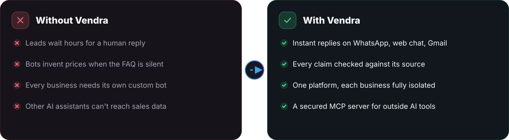
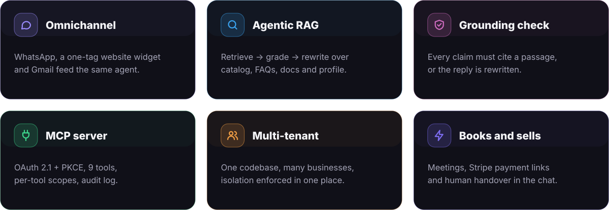
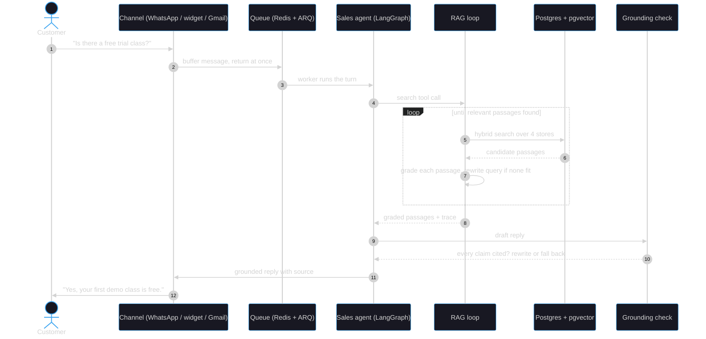

  

  
  
  
  
  

  <a href="#01"><b>Why</b></a> &nbsp;·&nbsp; <a href="#02"><b>Features</b></a> &nbsp;·&nbsp; <a href="#03"><b>Architecture</b></a> &nbsp;·&nbsp; <a href="#04"><b>Results</b></a> &nbsp;·&nbsp; <a href="#05"><b>Production</b></a> &nbsp;·&nbsp; <a href="#06"><b>Stack</b></a> &nbsp;·&nbsp; <a href="#07"><b>Limits</b></a>

 

**Vendra gives any business its own AI sales agent.** It answers buyers on WhatsApp, in a website chat widget and over Gmail, from that business's own catalog, documents and FAQs. It books meetings, sends Stripe payment links in the chat and hands over to a human at any point. One platform serves many businesses, each fully isolated from the others.

> [!IMPORTANT]
> A sales agent that invents a price or a policy costs real money. Vendra's rule is simple: **no claim goes out unless a source supports it.** Every answer is retrieved, graded and checked against its sources before it is sent.

 

 

<b>One message, step by step</b> (sequence diagram)

 

| Part | What it does |
|---|---|
| **Channels** | WhatsApp, a one-script-tag website widget and Gmail feed the same agent. A new channel is one adapter module, and nothing in the agent changes. |
| **Sales agent** | A LangGraph router with specialist agents. It runs on a worker queue, so a web request never waits on an agent turn. |
| **Agentic RAG loop** | Searches all four knowledge stores at once (catalog, FAQs, documents, business profile), grades every passage, and rewrites the query when nothing relevant is found. |
| **Grounding check** | Every claim in a draft must cite a passage. If it can't, the reply is rewritten from its sources or replaced with "the team will confirm". |
| **MCP server** | OAuth 2.1 with PKCE, dynamic client registration, a consent page and refresh-token rotation; 9 tools with per-tool scopes, and every call is audit-logged. |
| **Observability** | Every search is stored as a retrieval trace. The dashboard's *Answer quality* tab shows the sources behind each answer. |

 

| Also measured | Before | After |
|---|---:|---:|
| Correct refusals on unanswerable questions | 100% | **100%** |
| Facts leaked across businesses | 0 | **0** |
| Citation precision (cited passage is a gold passage) | — | **99.5%** |
| Fabricated citations | — | **0** |
| Passages handed to the model, mean | 3.6 | **1.2** |
| Latency, median | 6.9 s | 13.1 s |
| Model cost per turn | $0.00056 | $0.00109 |

**Where the gain came from.** 25 of the 28 baseline failures were retrieval misses. Most were "store traps": the agent searched the FAQs for a rule that lives in a document. Searching every store at once fixed that whole class (2 of 15 → 15 of 15), and grading kept it affordable: the model saw 1.2 passages per answer instead of 3.6, and 99.5% of them were on topic.

 

| Decision | Why |
|---|---|
| **Agent on a worker + queue** | The API drops each turn on a queue and returns at once. A slow model call never blocks a web request or a webhook. |
| **Tenant isolation in one place** | Written and tested once, never re-implemented per feature. 0 cross-tenant leaks in the evaluation. |
| **Grounding check after generation** | Retrieval quality alone doesn't stop a model from embellishing. Checking the finished draft does. |
| **Retrieval traces stored for every answer** | When an answer is wrong, the trace shows whether retrieval, grading or writing failed. |
| **OAuth 2.1 for outside AI clients** | Other assistants get scoped, revocable, audited access instead of a shared API key. |
| **One-switch rollback** | A single setting returns retrieval to single-shot, with no deploy needed. |
| **Measured, not assumed** | An 81-question evaluation, 26 MCP end-to-end tests, and suites for auth, channels, rate limiting and the widget. |

 

  

  
  
  
  
  
  
  

 

- **Latency roughly doubled** (6.9 s → 13.1 s median) because grading and the grounding check are extra model calls. That is fine on WhatsApp, where replies are batched anyway; it is the first thing to optimise for the website widget.
- **The evaluation is one run on two businesses.** The rewrite step mattered little on this corpus and should matter more on larger, messier ones, which is untested.
- **Aggregation questions** ("which courses are under 40,000 and online?") need a structured catalog query rather than similarity search.

 

  
   The source code is private. Happy to walk through it in an interview.

