  

  
  
  
  

**Vendra gives any business its own AI sales agent.** The agent answers buyers on WhatsApp, in a website chat widget and over Gmail, from that business's own catalog, documents and FAQs. It books meetings, sends Stripe payment links in the chat and hands over to a human at any point. One platform serves many businesses, each fully isolated from the others.

Two things make it more than a chatbot: **every answer is retrieved, graded and checked against its sources before it is sent**, and **other AI assistants can use Vendra as a tool** through its own OAuth-secured MCP server.

## Architecture

  

| Part | What it does |
|---|---|
| **Channels** | WhatsApp, a one-script-tag website widget and Gmail all feed the same agent. A new channel is one adapter module; nothing in the agent changes. |
| **Sales agent** | A LangGraph router with specialist agents. It runs on a worker and queue, so a web request never waits on an agent turn. |
| **Agentic RAG loop** | Searches all four knowledge stores at once (catalog, FAQs, documents, business profile), grades every passage, and rewrites the query and searches again when nothing relevant is found. |
| **Grounding check** | Every claim in a draft reply must cite a passage. If it can't, the reply is rewritten from its sources, or replaced with "the team will confirm". |
| **MCP server** | OAuth 2.1 with PKCE, dynamic client registration, a consent page and refresh-token rotation; 9 tools with per-tool scopes, and every call written to an audit log. |
| **Observability** | Every search is stored as a retrieval trace, and the dashboard's *Answer quality* tab shows the sources behind each answer. |

## Measured results

The same 81 questions over two businesses, asked to the same agent twice: once with the original single-shot retrieval, once with the agentic loop and grounding check. Nothing was mocked. Each question went through the real router, specialists, tools and prompts, against a real Postgres + pgvector database.

| Measure | Before (single-shot) | After (agentic) |
|---|---:|---:|
| Answer accuracy, answerable questions | 57.6% | **92.4%** |
| Hallucination rate | 8.6% | **1.2%** |
| Retrieval recall | 59.1% | **95.5%** |
| Context precision (passages on topic) | 28.4% | **99.5%** |
| Replies carrying a citation | 0% | **96.9%** |
| Citation precision | — | **99.5%** |
| Correct refusals on unanswerable questions | 100% | 100% |
| Facts leaked across businesses | 0 | 0 |
| Latency, median | 6.9 s | 13.1 s |
| Model cost per turn | $0.00056 | $0.00109 |

**Where the gain came from.** 25 of the 28 baseline failures were retrieval misses. Most were "store traps": the agent searched the FAQs for a rule that lives in a document. Searching every store at once fixed that whole class (2 of 15 → 15 of 15). Grading kept it affordable: the model saw 1.2 passages per answer instead of 3.6, and 99.5% of them were on topic.

**The trade-off.** Grading and the grounding check are two extra model calls, so median latency roughly doubled. That is fine on WhatsApp, where replies are already batched, and it is the first thing to optimise for the website widget.

## Production practices

- **Tenant isolation** is enforced in one place and tested: 0 cross-tenant leaks in the evaluation.
- **Security:** auth on every route, rate limiting, a guarded internal webhook, OAuth 2.1 for outside AI clients.
- **Testing:** an 81-question retrieval evaluation, 26 end-to-end tests for the MCP server, and test suites for auth, channels, rate limiting and the widget.
- **Safe rollout:** one setting switches retrieval back to single-shot, so the new loop can be rolled back without a deploy.
- **Deployment:** Nginx with TLS in front of FastAPI and a background worker on a Linux server, with Postgres + pgvector and Redis.

## Tech stack

  
  
  
  
  
  
  
  
  
  

---

  Built by <a href="https://github.com/ahmed-hussain-ai"><b>Ahmed Hussain</b></a> · <a href="https://ahmedhussain.tech">ahmedhussain.tech</a> 
  The source code is kept in a private repository. Happy to walk through it in an interview.

